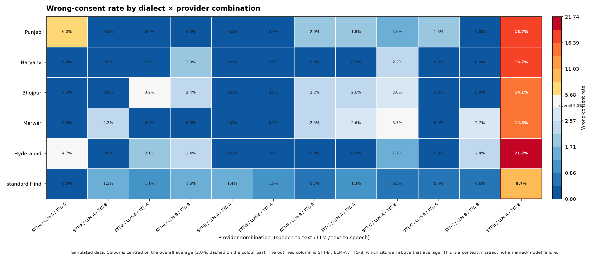

# Ji isn't always yes: catching context failures before they become complaints

*A case study for Bolna's Product Manager role, by Shruti Bajpai. The call script, scenario and numbers in the scenario are a simulation built to illustrate the problem. None of it is Bolna data.*

## 1. The problem

A voice agent hears "ji" and takes it as consent. In Indian speech, "ji" is a politeness marker, not an answer. Its meaning depends on four things.

- **Word pairing.** "Haan ji" means yes. "Nahi ji" means no. "Bas ji" means stop. "Ji?" means "sorry, what?" "Achha ji?" can mean "really?", which is doubt, not agreement.
- **Tone and repetition.** A soft, single "ji" is usually yes. A fast "ji, ji, ji" often means "get on with it". It can also be sarcastic.
- **Dialect:**
  - Punjabi: "Hun ji" means "go on, I'm listening".
  - Bhojpuri: "Ji, ho jaai" means "it'll get done", with no date attached.
  - Marwari (illustrative): "Ji hukum" is a respectful acknowledgement, not agreement to a time.
  - Hyderabadi (illustrative): "Haau ji, dekhte" means "yes, let me see", a soft deferral.
  - Lucknow and UP, beyond "ji" (my own observation as someone from UP): "kahe" shifts with pitch, stretch and pairing. A high, stretched "Kaaaahe?" means why? "Kahe se" means because. "Kahe" after something has already happened is a complaint: why is this happening? "Kahe ji" asks why, with respect or with aggression, depending on tone. One short word can be a question, a reason, a complaint or a challenge, so intent needs pitch and context, not just the word.
- **Network drop.** On a weak signal, the agent hears fragments of a sentence. The "ji" at the start and end gets through, and the "but" in the middle is lost.

The speech model can transcribe every word correctly and the agent still gets the call wrong.

**Wouldn't the customer's language and location fix this?** It helps the agent speak Punjabi, not read intent. "Hun ji" is clear Punjabi; whether it means "go on" or "yes" lives in tone and context. Profiles also drift from the real call: people code-switch, a relative picks up, or the client runs one Hindi agent for all of North India. And a signal drop loses "2 din aur" in any language. Even with the right language and profile, the agent can hear every word correctly and still read the intent wrong.

## 2. The stacked angle

The failure stacks in two ways.

**1. Layers stack inside one call.** A dialect phrase alone might pass. A weak signal alone might trigger a repeat request. A fast "ji ji" alone might be harmless. Together, in one call, they produce a wrong booking. Testing each layer on its own will not catch this.

**2. The provider stack.** Bolna customers combine a speech-to-text, an LLM and a text-to-speech provider. Errors concentrate on particular combinations. A community post on Bolna's blog shows this. Average latency was 820ms and the dashboard was green, while one provider combination had spiked to 2,242ms with a 15% error rate ([source](https://www.bolna.ai/blog/when-one-provider-combo-goes-down)).

So the analysis has to slice failures by **dialect × word pairing × provider combination**. Averages hide the cluster.

## 3. The call (simulated script)

Collections call for XYZ Finance, Punjab region. The caller is Gurpreet. His ₹8,000 EMI is due on the 5th.

| Speaker | Says | What it really means |
|---|---|---|
| Agent | Asks him to pay the EMI today. | |
| Gurpreet | "Hun ji..." | Go on, I'm listening. |
| Agent | "Dhanyavaad! Kya main aaj shaam 6 baje ka payment schedule kar doon?" | Takes "hun ji" as yes. |
| Gurpreet (weak signal) | "Ji, ke keh rahe... *(audio breaks)*" | Sorry, what did you say? |
| Agent | Repeats the question. | |
| Gurpreet | "Ji, main jaanta hoon, par... *(drop)* ...2 din aur... *(drop)* ...lag jayenge ji." | I know, but I need 2 more days. |
| AI hears | "Ji, main jaanta hoon... ji." | Reads it as yes. |
| Agent | "Dhanyavaad, ji. Payment aaj shaam 6 baje schedule ho gaya hai." | Books a promise he never made. |
| | The line drops. The AI ends the call. | |

**Four failures in one call:**
1. "Hun ji" was read as consent.
2. "Ke keh rahe" was a repeat request, but the agent didn't learn from it that the line was weak.
3. The "par... 2 din aur" was lost in drops, and the two "ji"s were kept.
4. A payment was locked on a partial reply, then the call ended without confirming it.

**The outcome.** Gurpreet gets a reminder for a promise he never made. The debit may bounce, with a late charge. He's tagged for defaulter follow-up. The dashboard says "payment scheduled, call completed".

## 4. Why nobody notices

In the scenario, this dialect and provider combination runs at a 15% error rate. The agent retries 2–3 times and repeats the same error. Five callers have bad experiences over a few weeks, but never 3 within 10 days.

Under TRAI's amendment of 18 September 2026 (press release 119/2026), action against a sender can start after 3 complaints in 10 days if the operator's AI system also flags the number. The old threshold was 5. Automated calls must also be declared in advance ([source](https://www.trai.gov.in/sites/default/files/2026-09/PR_No119of2026.pdf)). Here, the threshold never trips, so the problem stays invisible. The next cluster could get the client's number flagged.

## 5. How I'd find it as PM

I'd ask the call logs plain-English questions, and an AI writes the SQL. For example:
- "Which calls in Punjab ended with a payment scheduled after a repeat request or a signal drop?"
- "What is the wrong-consent rate by dialect, word pairing and provider combination?"
- "Which calls had a 'ji'-only reply right before a booking?"

I check the logic of each answer against the transcripts and recordings. The root cause is that the words were heard right and the intent was read wrong.

## 6. Proposed fixes

1. **Never lock a payment or date on a partial reply or a dropped call.** Reconfirm by SMS or a callback.
2. **Add a confirm step when consent rests on "ji" alone.** For example: "Toh aaj shaam 6 baje, theek hai?"
3. **Add a failure view in observability, sliced by dialect × word pairing × provider combination,** so FDEs and customers see the cluster, not the average.
4. **Add a complaint-risk early warning** that fires on repeat dials, retry loops and "stop calling" signals, well before TRAI's 3-in-10 threshold.

## 7. How we'd measure it

- Wrong consents per 1,000 calls.
- Retry loops per call.
- Time from first failure to a named cause.
- Risk flags raised before any complaint is filed.

## 8. Demo (simulated data)

I used AI tools to build a simulated log of 5,000 calls (16 Sep to 24 Nov 2026), then asked it 6 plain-English questions. For each one, an AI wrote the SQL. All clients, providers and calls in it are fictional.

- **The average looks fine.** The overall wrong-consent rate is 3.0% (150 calls).
- **The combination is the problem, not one provider.** STT-B / LLM-A / TTS-B runs at 15.03% (107 of 712 calls). Every other combination sits at about 0.5–1.6%.
- **Stacking multiplies it.** When tone, a signal drop and an ambiguous "ji" stack on that combination, the rate is 36.3% (101 of 278). Unstacked calls on every other combination are at 0.3%.
- **Bookings after a weak reply.** 24 of 42 Punjab payments booked after a repeat request or a signal drop were wrong consents (57%). 52 of 158 bookings after a lone "ji" were misreads (33%).
- **Retry loops repeat the error.** There are 3 loops. In one, a Punjab "hun ji" caller was called 4 times, and a payment was booked each time.
- **TRAI never fires.** The 5 complaints came on 1 Oct, 9 Oct, 24 Oct, 8 Nov and 20 Nov. No 10-day window has more than 2, so the 3-in-10 trigger never trips.

## 9. A question for Prateek

Syl already makes short replies like "haan" and "ji" far easier to hear. This case is about the next step: what the agent decides after it hears them. Has Bolna already solved this context layer? If not, this is how I'd find it and measure it.
