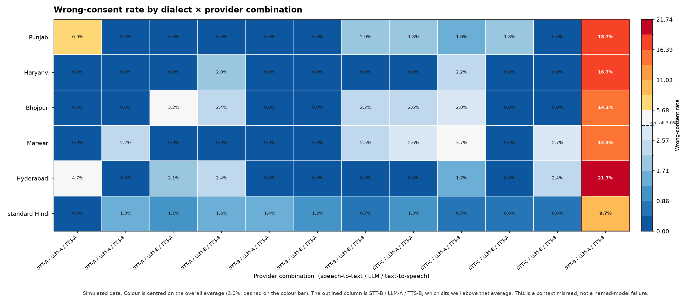

# 'Ji' isn't always yes

**Shruti Bajpai**, Founder moving into product management

A case written for Bolna, on catching context failures in Indian voice calls before they become complaints.

In Indian voice calls, "ji" is a politeness marker, not an answer. "Haan ji" means yes. "Hun ji" (Punjabi) means "go on, I'm listening." "Ji?" means "sorry, what?" Tone, dialect and a dropped signal can change the meaning, so a voice agent can log a payment the caller never agreed to. Dashboards still look fine, because the average hides the cluster.

This repo has the case write-up and a working demo on a simulated call log.

## This data is SIMULATED

The 5,000-call log, the clients, the callers and the provider labels are all fictional. Providers are generic labels such as `STT-B`, `LLM-A` and `TTS-B`. None of this is Bolna production data, and no real customers are in it.

I planned and wrote this case. The demo data is simulated: I generated it with AI tools, and AI wrote the SQL from my plain-English questions.

Failures are framed as context misreads — the words can be heard correctly and the intent still read wrong — not as a problem with a named model.

## Key findings

On 5,000 simulated calls (16 September to 24 November 2026):

- **Overall wrong-consent rate: 3.0%** (150 calls). The average looks fine.
- **One speech-to-text + LLM + text-to-speech combination is at 15.03%** (107 of 712 calls on STT-B / LLM-A / TTS-B). Every other combination sits at about 0.5–1.6%.
- **When faults stack, the rate is 36.3%** (101 of 278): tone, a signal drop and an ambiguous "ji" on that same combination. Unstacked calls on every other combination are at 0.3%.
- **3 retry loops** repeat the same error. In one, a Punjab caller whose "hun ji" means "go on" had a payment booked 4 times.
- **5 complaints**, on 1 October, 9 October, 24 October, 8 November and 20 November. No 10-day window has more than 2, so TRAI's 3-in-10-days trigger never fires.



## What's in this repo

| File | What it is |
|---|---|
| [Bolna_Case_Ji.pdf](Bolna_Case_Ji.pdf) / [Bolna_Case_Ji.md](Bolna_Case_Ji.md) | The two-page case |
| [DEMO.md](DEMO.md) | Six plain-English questions, the SQL an AI wrote for each, the result, and a one-line takeaway |
| `calls.csv` | The 5,000-row simulated call log |
| `chart_failure_by_dialect_combo.png` | The chart above |
| `generate.py` / `demo.py` | Scripts that rebuild the log, the demo write-up and the chart |
| `results/` | CSV of each query result |

`calls.duckdb` is not committed; `demo.py` can regenerate it.

## How to rerun

With Python 3 and `pandas`, `numpy`, `duckdb` and `matplotlib`:

```bash
python3 generate.py && python3 demo.py
```

`generate.py` uses a fixed seed (`42`) so the same 5,000 rows are produced each time.
